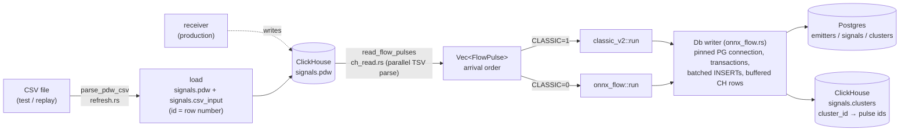
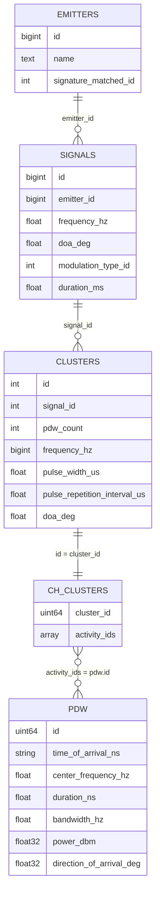
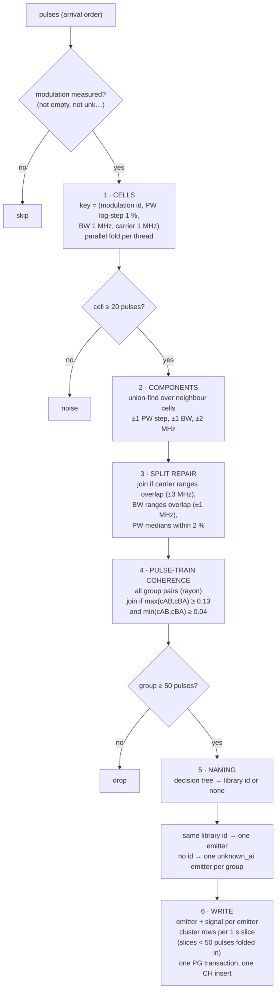
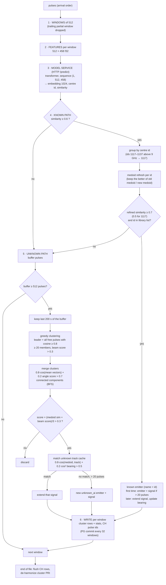
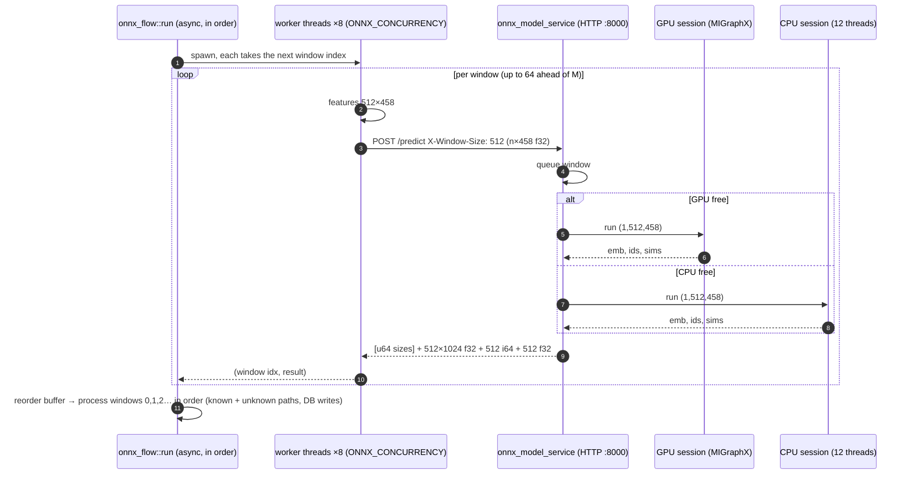
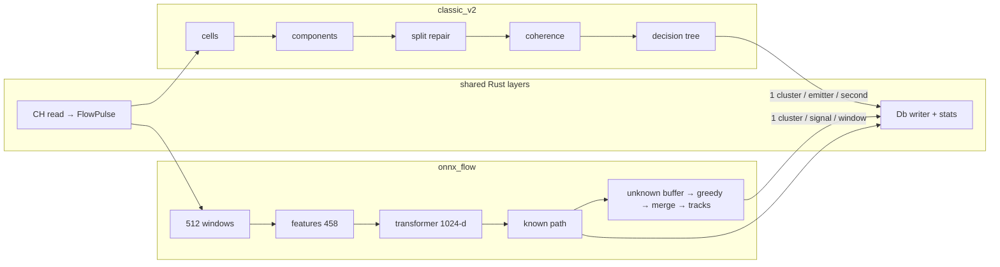

# Implementation — every level, both engines

Companion to `HOW_IT_WORKS.md` (short version) and `FILES.md` (file list).
Numbers in brackets are the defaults; every one is an environment variable
(`FlowCfg` in `onnx_flow.rs`, `ClassicCfg` in `classic_v2.rs`).

---

## 0. Shared layers (both engines)



| Level | Code | Detail |
| --- | --- | --- |
| Input record | `FlowPulse` | `input_id` (row number, CH join key), `freq_hz`, `power_dbm`, `bandwidth_hz`, `duration_ns`, `doa_deg`, `snr_db`, `toa_ns`, `modulation` — no ground-truth columns |
| Read | `ch_read::read_flow_pulses` | `SELECT … FROM signals.pdw ORDER BY id`, TSV, rayon parse; Float32 columns parsed as `f32` |
| Emitter row | `Db::insert_emitter` | name = library id (`"1113"`, with `signature_matched_id`) or `"unknown_ai"` |
| Signal row | `Db::insert_signal` | first member's freq/BW/power/SNR (truncated), bearing, modulation id, duration = TOA span |
| Cluster row | `Db::write_clusters_gap` → `stats()` | count, first TOA, mean/min/max/std of freq, power, PW, BW, DOA; PRI statistics (§3.6); one multi-row INSERT … RETURNING id |
| Cluster → pulses | same | `(cluster_id, ['<input_id>', …])` rows buffered, sent in ≤ 8 MB INSERTs |
| Timing | `layer_timing` | `LAYER|<stage>|<ms>` per stage |



---

## 1. Classic engine (`classic_v2.rs`)



### 1.1 Cells
`wc = round(ln(max(PW µs, 0.05)) / ln(1.01))`, `bc = round(BW / 1 MHz)`,
`fc = round(freq / 1 MHz)`; modulation interned to an integer. Cells under
`CLASSIC_MIN_CELL` [20] pulses are noise (spurious measurements).

### 1.2 Components
Union-find: a cell joins every existing cell at `(m, wc±1, bc±1, fc±2)`.
Handles measurement jitter that spreads one emitter over adjacent cells.

### 1.3 Split repair
For each component: 2nd/98th percentile of carrier and BW, median PW
(selection, O(n)). Join two components if both ranges overlap
(carrier ± `CLASSIC_MERGE_F_HZ` [3 MHz], BW ± `CLASSIC_MERGE_BW_HZ` [1 MHz])
and PW medians differ ≤ `CLASSIC_MERGE_PW_REL` [2 %].

### 1.4 Pulse-train coherence
```
coherence(A → B):
  sample ≤ 3000 pulses of A evenly
  for each: gap = toa_A − (latest toa_B before it), rounded to 1 µs
  share = (pulses in the 4 most common gap values) / sampled pulses
same emitter  ⇔  max(c(A→B), c(B→A)) ≥ 0.13  and  min(…) ≥ 0.04
```
Two modes of one radar (or two hops of an agile radar) are emitted on one
clock, so the gaps repeat; unrelated radars give near-uniform gaps
(measured on the corpus: same emitter max ≥ 0.19 / min ≥ 0.06, different
emitters ≤ 0.14 / ≤ 0.09). The two-way rule rejects a one-way "beat" between
PRIs (e.g. 2116 µs vs 220 µs).

### 1.5 Naming (library decision tree)
Group features: carrier mode (0.1 MHz bins), BW mode, PRI = most common
TOA interval (> 0.5 µs, 1 µs bins), PW 99th percentile, share of `lfm_up`.

| Rule (in order) | Library id |
| --- | --- |
| BW ≥ 6 MHz | none (unknown) |
| carrier 2898–2905 MHz | 1113 MF03 |
| carrier 2848–2852 | 1106 PSR3 |
| carrier 2748–2752 | PW ≥ 86 µs → 1107 PSR4, else 1104 PSR1 |
| carrier 2798–2822 | 1116 PSR5m2 |
| carrier 2858–2892 | lfm_up ≥ 80 % → 1109 MF04; carrier 2874–2876.5 and PRI < 140 µs → 1105 PSR2; else 1108 PSR5m1 |
| otherwise | none (unknown) |

### 1.6 Write
Members sorted by TOA; slices of `CLASSIC_CLUSTER_SEC` [1 s];
slices < `CLASSIC_MIN_SLICE` [50] pulses merge into the neighbour. PRI per
slice skips gaps < 1 µs (each pulse is reported by two receivers).

---

## 2. ONNX engine (`onnx_flow.rs` + `onnx_model_service`)



### 2.1 Windows
`n_win = ⌊pulses / 512⌋`; pulses of the last partial window are not processed
(the Python reference does the same).

### 2.2 Features (`window_features`) — 458 per pulse, f32

| Index | Feature | Formula |
| --- | --- | --- |
| 0 | frequency | `(f32(freq_hz) / 1e6 − 50) / 10950` |
| 1 | power | `(f32(power_dbm) + 100) / 100` |
| 2–201 | PW kernels | `exp(−(pw − c_k)² / (2 σ_k²))`, `pw = clamp(PW µs, 0.1, 300)`, 200 centres `c_k` log-spaced 0.1…300 µs |
| 202–457 | TOA-lag kernels | `Σ_j exp(−(|t_i − t_j| − c_k)² / (2 σ_k²))` over the 41 pulses `j` centred on `i` (centre clamped to [20, 491] inside the window), 256 centres log-spaced 10…5000 µs |

`σ_k = ⅔ · min(gap to previous centre, gap to next centre)`. Only kernels
whose exponent is < 30 are evaluated (walk outwards from the nearest centre);
the result equals the full 256-kernel sum to f32 precision (unit-tested).

### 2.3 Model call and service



* Request: `n × 458` little-endian f32; header `X-Window-Size: 512`;
  each window runs as one sequence (the transformer attends across the 512
  pulses — never send pulses one by one).
* Reply: 24-byte header (byte sizes), embeddings `n × 1024` f32, centre ids
  `n` i64, similarities `n` f32.
* Client retries 5× (0.2 → 3.2 s backoff); service listen backlog 256.
* GPU MIGraphX ~36 ms/window, CPU ~132 ms/window; hybrid ≈ 33 ms/window.

### 2.4 Known-emitter path (Python `handle_known_emitters_vectorized`)
1. `id ∈ [1117, 1137]` and freq > 9 GHz → `1117`.
2. Pre-mask: similarity ≥ `ONNX_KNOWN_DOT` [0.6].
3. Per id (sorted): rows `E`; `sim_old = E·medoid_old` (or the model's
   similarities if no medoid yet); candidate medoid = `argmax_i Σ_j e_i·e_j`
   (computed as `argmax_i e_i · Σ_j e_j`); if mean(new) > mean(old) and
   rows > 30 → store the new medoid and use its similarities.
4. Known ⇔ refined similarity ≥ `ONNX_SIM_THR` [0.7] (`ONNX_SIM_THR_1117`
   [0.5] for 1117) **and** id ∈ {1104, 1105, 1106, 1107, 1108, 1109, 1113,
   1115, 1116, 1117}.
5. Per id in order of appearance: no signal yet and > 20 pulses → insert
   emitter (`name = id`, signature id) + signal; signal exists → extend its
   power/DOA history, update bearing and duration. One cluster row per id per
   window.

### 2.5 Unknown path (Python `handle_unknown_pulses_buffered` → `simple_clustering`)
1. Append non-known pulses (with embeddings) to the buffer; when it holds
   ≥ 512 pulses take those within 200 s of the newest and clear it.
2. **Greedy clustering**: for each free pulse `i`: members = free pulses
   with `e_i·e_j ≥ 0.8`; if ≥ 20 → label them; keep the cluster if its beam
   score > 0.3. Beam: peak = most powerful pulse, bearing = power-weighted
   mean of DOA of peak ±2 pulses; score = share of pulses within ±40° of it.
3. **Merge**: cluster vector = mean embedding; for every pair
   `0.8·cos + 0.2·angle_score(Δbearing) > 0.7`
   (angle score 1 up to 20°, cos² fall-off to 0 at 40°); connected
   components (BFS) become merged clusters; medoid =
   `argmax_i e_i·Σe`; score = (mean medoid similarity + beam score) / 3.
4. Score > 0.3 → **track match** against earlier unknown medoids:
   `0.8·cos(medoid, track) + 0.2·cos²(Δbearing/40°·π/2)`; > 0.5 → same
   track (extend its signal, or create one when the track reaches > 20
   pulses); otherwise new track → new `unknown_ai` emitter + signal when
   > 20 pulses. Bearing of the signal re-estimated from all its pulses.

### 2.6 Cluster statistics (both engines, `stats()`)
PRI from TOA intervals of the cluster's members (in member order):
skip gaps < 1 µs → IQR filter (≥ 4 values) → histogram with 3 µs bins.

| Estimator | Use |
| --- | --- |
| Python: tallest bin, mean of its points | classic; ONNX with `ONNX_PRI_ESTIMATOR=python` |
| fundamental: shortest bin with ≥ 25 % of the tallest, median of its points | ONNX default |

ONNX end of file: a cluster whose PRI is k × (its signal's median cluster
PRI), k ≥ 2 within 2 %, is divided by k (de-harmonization; statistics only).

### 2.7 Writes and transactions
PG `BEGIN` every 32 windows (`ONNX_COMMIT_EVERY`), all cluster rows of a
window in one INSERT; CH pulse-id rows buffered to 8 MB; final flush and
commit at the end.

---

## 3. Side by side



| Level | Classic | ONNX |
| --- | --- | --- |
| unit of work | whole file at once | 512-pulse windows, stateful in order |
| representation | measured parameters (mod, PW, BW, carrier) | 458 hand features → 1024-d learned embedding |
| grouping | parameter cells + timing coherence | cosine ≥ 0.8 greedy + merge + tracks |
| known radar | decision tree on carrier/PW/BW/PRI/modulation | model centre id + similarity thresholds |
| cluster row | emitter × 1 s | signal × window |
| hardware | all CPU cores (rayon) | GPU + CPU (model), CPU (features, post-processing) |
| time per file (median) | 108 ms | 6.0 s |
